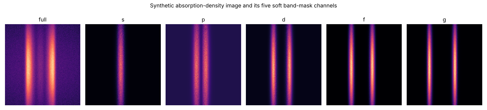
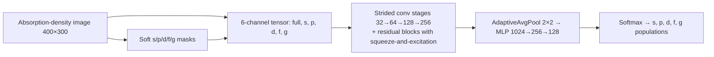

# Physics-informed CNN for five-orbital population readout from cold-atom absorption images

A PyTorch pipeline that reads the **fractional populations of the s, p, d, f and g Bloch bands** directly from a single band-mapping absorption-density image of ultracold atoms in an optical lattice. It is meant as a learned alternative to conventional 1D five-band erf curve fitting.

> **Scope of this repository.** It contains the model, training, evaluation and ablation **code only**. Experimental images, noise banks, trained checkpoints and the manuscript are not included. Every script that needs laboratory data reads it from a `data/` directory (or `ORBITAL_DATA_ROOT`) that you supply.
> `demo_synthetic.py` runs end to end without any lab data.



*Synthetic example generated by `demo_synthetic.py` (no experimental data).*

## Key ideas

| Idea | What it does | Where |
|---|---|---|
| **Physics-guided six-channel input** | The noisy image plus five copies weighted by soft logistic masks over the theoretical s/p/d/f/g Brillouin-zone intervals (`[0, 0.5Δ], [0.5Δ, Δ], …, [2Δ, 2.5Δ]`). The masks give the CNN a physical prior while keeping the blurred signal shared by adjacent bands | `data_generator3.py` → `create_soft_band_masks`, `build_six_channel_input` |
| **Sim-to-real online noise** | Training stores only 5,000 clean theory-parameter sets. Every epoch re-renders each image with newly sampled noise (real residual patches from experimental references, PCA fringe reconstructions, white noise). Validation uses **held-out** noise sources | `data_generator3.py` → `NoiseAugmentor`, `OnlineTwoViewDataset` |
| **Mask-geometry jitter** | Band centre, spacing Δ and boundary softness are perturbed independently for each view, so the model cannot rely on perfectly known boundaries | `jittered_mask_geometry` |
| **Two-view consistency loss** | Two independently noised views of the same physics; loss = MSE(view₁) + MSE(view₂) + λ·MSE(view₁, view₂) | `train3.py` → `two_view_loss` |
| **Simplex output** | Softmax head, so the five populations are non-negative and sum to 1 | `model_v3.py` |



## Repository layout

| File | Purpose |
|---|---|
| `model_v3.py` | Six-channel CNN (residual + SE blocks, softmax head) |
| `data_generator3.py` | Five-band erf theory renderer, soft band masks, online sim-to-real noise, two-view dataset |
| `train3.py` | Training with two-view consistency loss and early stopping (MPS / CUDA / CPU) |
| `predict_real_v3.py` | Preprocess paired signal/reference TIFFs (background subtraction, FFT fringe removal) and predict real scans |
| `evaluate_diagnostics_v3.py` | Validation metrics, error-correlation heatmap, Grad-CAM, CNN vs. 1D curve-fit comparison |
| `demo_synthetic.py` | Data-free demo: synthetic image → six channels → forward pass |
| `model.py`, `data_generator2.0.py`, `evaluate_diagnostics.py`, `predict_real_experiment.py` | Single-channel V2 baseline, used by ablation variants A0–A2 |
| `ablation/` | Controlled ablation study (see below) |

## Quick start

```bash
conda env create -f environment.yml
conda activate cnn-v3

# No lab data needed
python demo_synthetic.py --figure docs/six_channel_synthetic.png
```

With your own data in `data/` (`BandMapping_data/<scan>/BG/BG_s.tif, BG_r.tif, *usAveS.tif, *usAveR.tif` and `Extracted_Noise_Bank/global_pca_fringes.npy`):

```bash
python data_generator3.py          # theory-parameter bank + noise split + previews
python train3.py                   # 150 epochs max, batch 64, early stopping (patience 20)
python evaluate_diagnostics_v3.py  # metrics, Grad-CAM, CNN vs. curve fit
python predict_real_v3.py --scan-dir data/BandMapping_data/<scan_name>
```

## Ablation study

`ablation/` trains six variants × three seeds on one fixed 750-example benchmark:

| Variant | Change |
|---|---|
| A0 | Single channel, white noise only |
| A1 | + real / PCA noise |
| A2 | + two-view consistency loss |
| A3 | + six-channel **soft** masks with geometry jitter (the V3 model) |
| A4 | Same as A3 but **hard** mask boundaries (tests boundary smoothing) |
| A5 | Soft masks deliberately shifted by +12 px (negative control) |

It also includes mask-robustness (centre / spacing errors) and region-counterfactual tests. See [`ablation/README.md`](ablation/README.md).

## Limitations

- Validation metrics are computed on simulated images with held-out noise. They are **not** real-data accuracy: no independent ground truth for orbital populations exists for the experimental scans.
- Grad-CAM shows which regions push an output up. It is not a segmentation of band boundaries.
- A high R² from conventional five-band fitting means the curve shape fits well. It does not by itself show that the fitted populations are correct.

## Author

Shuiyi Gong, University of Cambridge. Work done during a research project on machine-learning readout for optical-lattice experiments.

## License

MIT. See [LICENSE](LICENSE).
